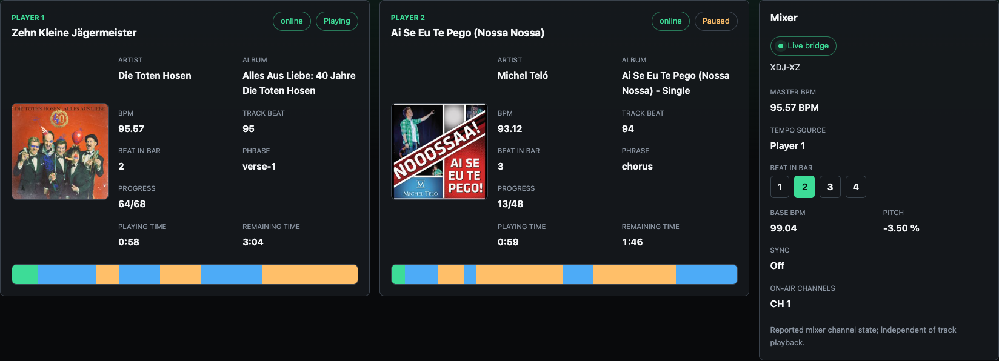
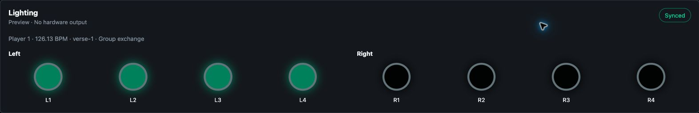
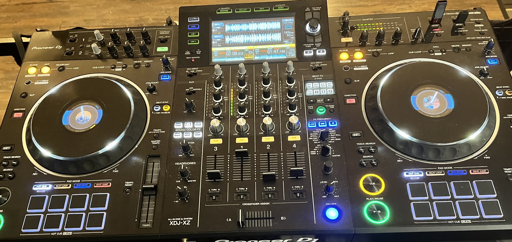

# ProDJ Beats

**[Deutsch](#deutsch) · [English](#english)**



*Live-Daten eines XDJ-XZ im Browser: zwei Decks und Tempo-Master im Überblick.
Geräteadressen sind für diesen Screenshot ausgeblendet.*

*Live XDJ-XZ data in the browser: two decks and the tempo master at a glance.
Device addresses are hidden in this screenshot.*



*Live-Aufnahme des Musters „All spots“: alle acht virtuellen RGB-PAR-Spots
leuchten gemeinsam zum Tempo-Master. Phrasenmuster ergänzen Fanning,
Gruppenwechsel, weiche Überblendungen und Beat-Pulse. Keine lokalen
Geräteadressen im Screenshot; weiterhin reine Vorschau ohne Hardware-Ausgabe.*

*Live capture of the “All spots” pattern: all eight virtual RGB-PAR spots light
up together to the tempo master. Phrase-driven patterns combine fanning, group
exchanges, smooth fades and beat pulses. No local device addresses appear in
the screenshot; this remains a software preview with no hardware output.*



*Die Hardware hinter den Live-Daten: der XDJ-XZ im Einsatz. ProDJ Beats ergänzt
sein eingebautes Display um eine größere Browseransicht.*

*The hardware behind the live data: an XDJ-XZ in use. ProDJ Beats complements
its built-in display with a larger browser view.*

## Deutsch

ProDJ Beats ergänzt vorhandene DJ-Hardware um eine größere Live-Anzeige im
Browser – beispielsweise auf einem Tablet neben dem eingebauten Display.
Das Projekt nutzt die Open-Source-Bibliothek
[beat-link von Deep Symmetry](https://github.com/Deep-Symmetry/beat-link), um
Daten aus dem ProDJ-Link-Netzwerk für eine gemeinsame Weboberfläche aufzubereiten.

Die Idee: Bewährte, funktionierende Geräte mit ergänzender Software länger und
vielseitiger nutzen. ProDJ Beats ist ein unabhängiges Entwicklungsprojekt;
es besteht keine Verbindung zu AlphaTheta oder Pioneer DJ.

### Aktueller Stand

Der Prototyp wurde mit einem **XDJ-XZ** live geprüft. Die Oberfläche zeigt,
soweit vom Gerät und vom geladenen Track verfügbar:

- Tracktitel, Interpret, Album und Cover.
- Wiedergabestatus, Laufzeit und Restzeit; rote Restzeitanzeige ab 20 Sekunden.
- BPM, Beat im Takt, absolute Track-Beatposition und musikalische Phrasen.
- Tempo-Master mit effektivem Tempo, Grund-BPM, Pitch und Sync-Status.
- Beat-Anzeige 1–4, gemeldete Masterübergaben und On-Air-Kanäle.
- Virtuelle Lighting-Vorschau mit acht RGB-PAR-Spots: links und rechts je vier,
  synchron zum Tempo-Master; keine Hardware-Ausgabe.
- Verbundene Geräte und deren vom Netzwerk gemeldete Adressen.
- Aufklappbare Verbindungsdiagnose: Bridge-Adapter, Playernummer, Statussenden
  und Empfang von Ankündigungen, Status, Beats und Metadaten.

Live-Daten und Fixture-Replay verwenden denselben Eventvertrag und dieselbe
Zustandsverarbeitung. Replay ermöglicht Entwicklung und Tests ohne DJ-Hardware.
Unbekannte Werte bleiben als solche erkennbar.

**Grenzen:** Andere Gerätemodelle sind durch die XDJ-XZ-Tests nicht automatisch
validiert. Master-Level-Regler, Audiopegel und Beat-FX-Einstellungen werden am
XDJ-XZ derzeit nicht ausgelesen. On-Air bezeichnet den gemeldeten Kanalzustand,
keine Audiopegelmessung. Die weitere Nutzung der **RB-DMX1** ist ein
Untersuchungsthema; eine Integration ist noch nicht umgesetzt.

### Lighting-Vorschau

Die acht virtuellen RGB-PAR-Spots ergänzen die Track-Anzeige um:

- **Fanning:** gespiegelte Lichtfolgen mit Hin- und Rücklauf.
- **Weiche Überblendungen:** Farben und Helligkeiten wechseln fließend zwischen
  den Beat-Ereignissen; die musikalische Phrase bestimmt die Farbpalette.
- **Beat-Pulse:** Helligkeitsimpulse im Mastertempo, mit stärkerem Akzent auf Beat 1.

Die Phrase steuert die Musterwahl:

| Phrase | Lichtmuster |
| --- | --- |
| Intro / Outro | Gespiegeltes Fanning mit Hin- und Rücklauf. |
| Verse / Bridge | Wechsel zwischen linker und rechter Vierergruppe sowie inneren und äußeren Spot-Paaren. |
| Chorus | Alle acht Spots auf Beat 1 und 3; Gruppenwechsel auf Beat 2 und 4. |
| Break | Gedämpfter Wash über alle acht Spots. |
| Andere oder fehlende Phrase | Wechsel zwischen Fanning, Gruppen und allen Spots alle vier Takte anhand der empfangenen Beats. |

Die Muster gehen mit weichen Überblendungen ineinander über. Die Oberfläche
zeigt das aktive Muster neben Tempo und Phrase an.

Live und Replay verwenden dieselbe Effektberechnung; die Animation berücksichtigt
auch die Replay-Geschwindigkeit. Echte Beat-Ereignisse synchronisieren die Effekte.
Ohne weitere Beats klingt das Licht aus, ohne selbstständig die Lichtfolge
fortzusetzen. Pause hält den Effekt; Master- und Trackwechsel setzen ihn bis zum
nächsten passenden Beat zurück. Bei Verbindungsverlust werden die Spots dunkel.

Das gemeinsame Lichtmodell verwendet normalisierte RGBW-Werte (Warmweiß) und
einen logischen Dimmer mit Fließkommapräzision. Die bestehenden Paletten nutzen
weiter RGB; Warmweiß bleibt dort zunächst 0. Das reine Ape-Labs-Fixture-Profil
für den **8-Kanal-/16-Bit-Modus** erzeugt acht Bytes in der Reihenfolge Rot grob/fein,
Blau grob/fein, Grün grob/fein, Warmweiß grob/fein gemäß der
[Herstellerbelegung](https://apelabs.com/de/manual/maxi/dmx.html).
Logischer Dimmer und Masterdimmer werden vor der abschließenden Quantisierung
auf alle vier Farbwerte angewendet; es gibt keinen eigenen Dimmerkanal.
Das Profil ist eine getestete Datenumrechnung ohne Patch oder Gerätekonfiguration.
DMX-Modus und Adressen werden später manuell eingestellt;
Standalone-Einstellungen, Presets, Gruppen und Pairing bleiben unberührt.

### Lokales Art-Net-Monitoring mit Protokol

Im bestehenden Astro/Vite-Entwicklungsprozess läuft ein einzelner Monitor-Sender.
Er liest die vorhandene Java-Bridge über `ws://127.0.0.1:8787/events` und verwendet
dieselbe Session und RGBW-Berechnung wie die Vorschau. Ein 30-Hz-Ausgabezyklus tastet
die Übergänge ab; ausschließlich echte Master-Beats schalten die Muster weiter.
Browser-Tabs und `?source=replay` steuern diesen Live-Monitor nicht.

Ziel ist fest **127.0.0.1:6454**, Art-Net **Universe 0**. In Hexler Protokol
ARTNET aktivieren und Universe 0 wählen. Die acht Profile belegen:

| Spot | DMX-Startadresse | Kanäle |
| --- | --- | --- |
| L1 | 1 | 1–8 |
| L2 | 9 | 9–16 |
| L3 | 17 | 17–24 |
| L4 | 25 | 25–32 |
| R1 | 33 | 33–40 |
| R2 | 41 | 41–48 |
| R3 | 49 | 49–56 |
| R4 | 57 | 57–64 |

Jedes Paket enthält 512 Kanalwerte; 65–512 bleiben 0. Protokol zeigt die einzelnen
8-Bit-Bytes, nicht automatisch den zusammengesetzten 16-Bit-Farbwert. Warmweiß
bleibt bei den bisherigen RGB-Paletten 0. Ohne Sync und bei Verbindungsverlust
werden Nullwerte gesendet. Fehlende weitere Beats lassen den letzten Puls ausklingen;
Pause hält entsprechend der gemeinsamen Lighting-Logik den Zustand.
Beim geordneten Beenden wird ein abschließendes Nullpaket gesendet.

Der Sender bindet ausschließlich Loopback mit automatisch gewähltem Quellport,
weil Protokol den Standardport 6454 bereits belegt. Er öffnet keinen zusätzlichen
HTTP-/WebSocket-Server und sendet weder ins LAN noch per Broadcast. ArtPoll/Discovery
und ein vollständiger Hardware-Controller sind nicht Bestandteil dieses lokalen
Monitorbetriebs. Änderungen der Entwicklungsintegration können einen Neustart über
`npm run dev` im bestehenden VS-Code-Terminal erfordern; keinen zweiten Start daneben
ausführen. Statischer Build und Preview starten keinen Monitor-Sender.

Der ArtDmx-Adapter prüft nullbasierte Port-Addresses (0–32767) und gerade
Nutzdatenlängen von 2–512 Bytes. Sequenzen laufen pro Port-Address von 1 bis 255
und dann auf 1. Loopback-UDP-Tests verwenden ausschließlich kurzlebige lokale Ports.
Ein erfolgreicher UDP-Send bestätigt nur die lokale Übergabe; den Empfang in
Protokol separat prüfen. Standalone-Einstellungen bleiben unberührt.

Die Vorschau steuert **keine Hardware** an. Die Anbindung physischer DMX-/Art-Net-
Ausgabe an die Anwendung, USB-Ausgabe und RB-DMX1-Integration sind noch offen.

### Einrichtung und Start

Voraussetzungen: **Node.js ab 22.12**, **npm ab 9.6.5** und **JDK 21 oder neuer**.
Für Live-Daten muss der Rechner das ProDJ-Link-Netzwerk der DJ-Hardware erreichen.
Ein Tablet benötigt Zugriff auf den Rechner, der die Anwendung ausführt.

```bash
npm ci
npm run bridge:deps
npm run dev
```

`npm run bridge:deps` lädt die Java-Abhängigkeiten herunter. `npm run dev` baut
die Bridge und startet **Web-App und Java-Bridge gemeinsam im Vordergrund**.
Beide Logs erscheinen im selben Terminal; `Ctrl+C` beendet beide Prozesse.
`npm start` ist gleichwertig. Keinen zusätzlichen Bridge-Prozess daneben starten.

Die Web-App läuft auf Port **4325**. Öffne die vom Terminal angezeigte Adresse.
Für ein Tablet verwende `http://<Adresse-des-Rechners>:4325/` und ersetze den
Platzhalter durch die erreichbare LAN-Adresse. Ergänze `?source=replay` für die
Demo mit Fixtures. Bei Verwendung eines eigenen Hostnamens prüfe die
`allowedHosts`-Einstellung in `astro.config.mjs`.

Die Bridge bleibt auf den lokalen Rechner beschränkt und nutzt Port **8787**.
Der Browser verbindet sich über `/events`; der Dev-Server leitet diese
WebSocket-Verbindung an die Bridge weiter. Ein statischer Web-Build allein
liefert keine Live-Daten; ein Deployment benötigt zusätzlich die laufende Bridge
und einen entsprechenden WebSocket-Proxy.

Java-Änderungen benötigen einen Neustart von `npm run dev`. Änderungen an der
Weboberfläche werden während der Entwicklung über HMR aktualisiert. Mehrere
Netzwerkadapter im selben Subnetz können die Adapterwahl und den Empfang
beeinflussen; die Bridge protokolliert ihre gewählte Adresse und Playernummer.

### Entwicklung und Prüfung

```bash
npm test
npm run check
npm run bridge:test
npm run fixture:replay
npm run build
```

Die Tests prüfen Eventvalidierung, Zustandswechsel, Live-/Replay-Verarbeitung
und die Java-Bridge. Anonymisierte Hardware-Aufzeichnungen mit dokumentierter
Herkunft liegen unter [recordings](src/infrastructure/recordings/README.md).
Diagnosewerte beschreiben beobachteten Empfang seit Verbindung/Geräterückkehr,
keine garantierte Aktualität. Erfolgreiche Fixtures ersetzen keine Hardwareprüfung.
Projektregeln stehen in [AGENTS.md](AGENTS.md) und
[.github/copilot-instructions.md](.github/copilot-instructions.md).

## English

ProDJ Beats adds a larger browser-based live display to existing DJ hardware –
for example, a tablet alongside the built-in screen. It uses the open-source
[beat-link library by Deep Symmetry](https://github.com/Deep-Symmetry/beat-link)
to bring ProDJ Link network data into a shared web interface.

The aim is to extend the useful life and capabilities of working DJ equipment
through complementary software. ProDJ Beats is an independent development
project, with no affiliation to AlphaTheta or Pioneer DJ.

### Current status

The prototype has been tested live with an **XDJ-XZ**. Where supported by the
device and loaded track, the interface shows:

- Track title, artist, album and artwork.
- Playback status, elapsed and remaining time; red remaining time at 20 seconds or less.
- BPM, beat within the bar, absolute track beat and musical phrases.
- Tempo master with effective tempo, base BPM, pitch and sync status.
- A 1–4 beat indicator, reported master handoffs and on-air channels.
- Virtual lighting preview with eight RGB-PAR spots: four on each side,
  synchronised to the tempo master; no hardware output.
- Connected devices and their network-reported addresses.
- Expandable connection diagnostics: bridge adapter, player number, own status
  sending and reception of announcements, status, beats and metadata.

Live data and fixture replay share the same event contract and state handling.
Replay supports development and testing without DJ hardware. Unknown values
remain visibly unknown.

**Limitations:** XDJ-XZ testing does not validate other hardware models.
Master-level knob position, audio meters and Beat FX settings are currently
unavailable on the XDJ-XZ. On-air represents reported channel state, not a
measurement of audio level. Further use of the **RB-DMX1** is under
investigation; integration has not been implemented.

### Lighting preview

The eight virtual RGB-PAR spots complement the track display with:

- **Fanning:** mirrored light sequences travelling out and back.
- **Smooth fades:** colors and brightness blend between beat events; the musical
  phrase determines the color palette.
- **Beat pulses:** brightness pulses at the master tempo, with a stronger accent
  on beat 1.

The phrase determines the pattern:

| Phrase | Lighting pattern |
| --- | --- |
| Intro / Outro | Mirrored fanning travelling out and back. |
| Verse / Bridge | Exchanges between the left and right banks of four, then inner and outer spot pairs. |
| Chorus | All eight spots on beats 1 and 3; group exchanges on beats 2 and 4. |
| Break | A subdued wash across all eight spots. |
| Other or missing phrase | Rotate between fanning, groups and all spots every four bars using received beats. |

Patterns transition with smooth fades. The interface shows the active pattern
alongside tempo and phrase.

Live and replay use the same effect calculation, including replay speed.
Actual beat events synchronise the effects. When beats stop arriving, the light
fades out without advancing the sequence on its own. Pause holds the effect;
master and track changes reset it until the next matching beat. A lost connection
turns the spots dark.

The shared lighting model uses normalized RGBW values (warm white) and a logical
dimmer with floating-point precision. Existing palettes still use RGB with warm
white set to 0. The pure Ape Labs **8-channel/16-bit fixture profile** encodes eight
bytes in red coarse/fine, blue coarse/fine, green coarse/fine, warm white coarse/fine
order according to the [manufacturer mapping](https://apelabs.com/de/manual/maxi/dmx.html).
The logical and master dimmers scale all four colors before final quantization;
there is no separate dimmer channel. This is a tested data conversion with no patch
or device configuration. DMX mode and addresses will
be configured manually later; standalone settings, presets, groups and pairing
remain untouched.

### Local Art-Net monitoring with Protokol

A single monitor sender runs inside the existing Astro/Vite development process.
It reads the existing Java bridge at `ws://127.0.0.1:8787/events`, reusing the same
session and RGBW calculation as the preview. A 30-Hz output loop samples transitions;
only real master beats advance patterns. Browser tabs and `?source=replay` do not
drive this live monitor.

The destination is fixed to **127.0.0.1:6454**, Art-Net **Universe 0**. Enable ARTNET
in Hexler Protokol and select Universe 0. Fixtures L1–L4 start at **1, 9, 17, 25**;
R1–R4 start at **33, 41, 49, 57**, each using eight channels. Packets contain 512
channel values; channels 65–512 remain zero. Protokol displays individual 8-bit
bytes rather than automatically combining them into 16-bit colors. Existing RGB
palettes leave warm white at zero. Waiting for sync and transport loss output
blackout. Missing beats fade the last pulse; pause holds the shared lighting state.
Orderly shutdown sends a final zero frame.

The sender binds only loopback with an automatically assigned source port because
Protokol already occupies port 6454. It opens no additional HTTP/WebSocket server
and sends no LAN traffic or broadcasts. ArtPoll/discovery and a complete hardware
controller are outside this local monitoring mode. Integration changes may require
restarting `npm run dev` in the existing VS Code terminal; never start a second copy.
Static build and preview do not start monitoring.

The ArtDmx adapter validates zero-based Port-Addresses (0–32767) and even payload
lengths of 2–512 bytes. Sequences run per Port-Address from 1 to 255 and wrap to 1.
Loopback UDP tests use short-lived local ports only. Successful sending confirms
local submission; verify reception separately in Protokol. Standalone settings
remain untouched.

The preview has **no hardware output**. Connecting physical DMX/Art-Net output to
the application, USB output and RB-DMX1 integration remain future work.

### Setup and start

Requirements: **Node.js 22.12 or newer**, **npm 9.6.5 or newer**, and **JDK 21 or
newer**. For live data, the computer must reach the hardware's ProDJ Link
network. A tablet must be able to access the computer running the application.

```bash
npm ci
npm run bridge:deps
npm run dev
```

`npm run bridge:deps` downloads the Java dependencies. `npm run dev` builds the
bridge and runs **the web app and Java bridge together in the foreground**.
Both logs stay in the same terminal; `Ctrl+C` stops both processes. `npm start`
is equivalent. Do not run a separate bridge alongside this command.

The web app uses port **4325**. Open the address printed in the terminal.
On a tablet, use `http://<computer-address>:4325/`, replacing the placeholder
with the computer's reachable LAN address. Add `?source=replay` for fixture
playback. If using a custom hostname, check `allowedHosts` in `astro.config.mjs`.

The bridge is restricted to the local computer on port **8787**. The browser
connects through `/events`, which the development server proxies to the bridge
over WebSocket. A static web build alone cannot provide live data: deployment
also requires the running bridge and a corresponding WebSocket proxy.

Java changes require restarting `npm run dev`; web UI changes use HMR during
development. Multiple network adapters on the same subnet can affect adapter
selection and reception. The bridge logs its selected address and player number.

### Development and verification

```bash
npm test
npm run check
npm run bridge:test
npm run fixture:replay
npm run build
```

Tests cover event validation, state transitions, shared live/replay handling and
the Java bridge. Anonymized hardware recordings and their provenance are documented
in [recordings](src/infrastructure/recordings/README.md). Diagnostics describe
observed reception since connection/device return, not guaranteed freshness.
Passing fixtures do not replace hardware verification.
See [AGENTS.md](AGENTS.md) and
[.github/copilot-instructions.md](.github/copilot-instructions.md) for project rules.

## Architektur / Architecture

```text
ProDJ Link → Java / beat-link → WebSocket events v2
                                     ↓
Fixture replay → shared parser and session → Astro / Preact UI
```

| Bereich / Area | Aufgabe / Responsibility |
| --- | --- |
| `apps/bridge/` | Java-Adapter und WebSocket-Ereignisse / Java adapter and WebSocket events |
| `src/domain/` | Eventvertrag und Fachmodelle / Event contract and domain models |
| `src/application/` | Gemeinsame Session und Zustandswechsel / Shared session and state transitions |
| `src/infrastructure/` | Live-Transport und Replay / Live transport and replay |
| `src/components/`, `src/styles/` | Oberfläche / User interface |
| `scripts/` | Entwicklungs-, Build- und Testbefehle / Development, build and test commands |

## Besonderer Dank / Special Thanks

Dieses Projekt profitiert von offenen Bibliotheken, öffentlich dokumentierten
Protokollen und dem Austausch in der DJ- und Entwicklergemeinschaft.
Vielen Dank an die Menschen und Projekte, die diese Arbeit ermöglichen und inspirieren.

This project benefits from open libraries, publicly documented protocols and
knowledge shared by the DJ and developer communities. Thank you to the people
and projects that make this work possible and inspire its development.

- [Deep Symmetry / beat-link](https://github.com/Deep-Symmetry/beat-link) –
  die Java-Bibliothek unserer Bridge / the Java library powering our bridge.
- [DJ Link Ecosystem Analysis](https://djl-analysis.deepsymmetry.org/) –
  öffentliche Protokollanalyse / public protocol research.
- [chrisle / rbxport](https://github.com/chrisle/rbxport) –
  Inspiration und Architekturimpulse / inspiration and architectural ideas.
- [evanpurkhiser / prolink-connect](https://github.com/evanpurkhiser/prolink-connect) –
  offene ProDJ-Link-Implementierung / an open ProDJ Link implementation.

Special thanks to **[brunchboy](https://github.com/brunchboy), evanpurkhiser, Maddix, Morgan Page, nichi, profbx,
Sean Tyas, shiz, syl, trancejesus, xorbxbx, and [AlphaTheta](https://alphatheta.com/)**.

Die Danksagung stellt keine offizielle Beteiligung oder Unterstützung dar.
These acknowledgements do not imply official involvement or endorsement.

## Lizenz / License

[MIT](LICENSE). Abhängigkeiten unterliegen ihren jeweiligen Lizenzen.
Dependencies retain their respective licenses.
