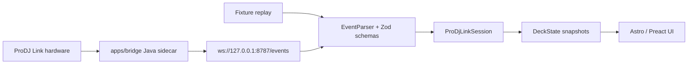

# Developer Notes

ProDJ Beats is split into a TypeScript application core and a Java bridge. The
core app owns event contracts, validation, state reduction and UI rendering. The
bridge owns ProDJ Link network integration and forwards normalized JSON events
over a local WebSocket endpoint.

## Event Flow



## Core Classes


## Canonical Event Envelope

All transport sources should emit the same shape:

```json
{
  "type": "beat",
  "version": 1,
  "ms": 1725728634353,
  "payload": {
    "beat": 263,
    "master": true,
    "onAir": true,
    "player": 1,
    "tempo": 129.92
  }
}
```

The TypeScript schemas live in `src/domain/events.ts`. New live transport work
should adapt into that contract instead of adding UI-specific event shapes.

## Boundaries

- `src/domain`: pure TypeScript models, schemas and parser classes.
- `src/application`: session-level use cases and reducers.
- `src/infrastructure`: fixtures and future browser transport adapters.
- `apps/bridge`: Java sidecar for `beat-link` integration.
- `src/content/docs`: prepared documentation content for future Starlight pages.

## Bridge Notes

The Java bridge is intentionally buildable without vendored JARs. Runtime
dependencies belong in `apps/bridge/lib/` and are ignored by Git. This keeps the
repository cross-platform and avoids committing binary runtime artifacts.

The bridge can be checked without hardware:

```bash
npm run bridge:build
npm run bridge:run
```

Without `beat-link` JARs, the bridge starts and publishes a `sys` event that
explains the missing runtime dependencies.
