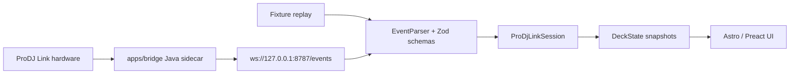
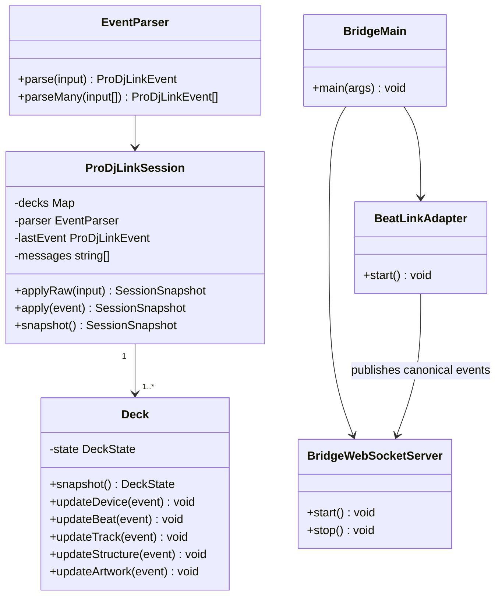

# Developer Notes

ProDJ Beats is split into a TypeScript application core and a Java bridge. The
core app owns event contracts, validation, state reduction and UI rendering. The
bridge owns ProDJ Link network integration and forwards normalized JSON events
over a local WebSocket endpoint.

## Event Flow



## Core Classes



## Canonical Event Envelope

All transport sources should emit the same shape:

```json
{
  "type": "beat",
  "version": 2,
  "ms": 1725728634353,
  "payload": {
    "beatWithinBar": 3,
    "trackBeat": 263,
    "master": true,
    "onAir": true,
    "player": 1,
    "tempo": 129.92
  }
}
```

The TypeScript schemas live in `src/domain/events.ts`. New live transport work
should adapt into that contract instead of adding UI-specific event shapes.

## Boundaries

- `src/domain`: pure TypeScript models, schemas and parser classes.
- `src/application`: session-level use cases and reducers.
- `src/infrastructure`: fixtures and future browser transport adapters.
- `apps/bridge`: Java sidecar for `beat-link` integration.
- `src/content/docs`: prepared documentation content for future Starlight pages.

## Bridge Notes

The Java bridge is intentionally buildable without vendored JARs. Runtime
dependencies belong in `apps/bridge/lib/` and are ignored by Git. This keeps the
repository cross-platform and avoids committing binary runtime artifacts.

The bridge can be checked without hardware:

```bash
npm run bridge:build
npm run bridge:run
```

Without `beat-link` JARs, the bridge starts and publishes a `sys` event that
explains the missing runtime dependencies.

## Version 2 event contract and lifecycle

- `beatWithinBar`: 1–4, or `null` when unknown. `trackBeat`: absolute 1-based
  track position, or `null`. Never substitute one for the other.
- A phrase's `startBeat` is an absolute 1-based beat; `beats` is its length.
  `Deck` computes the current phrase using the half-open interval
  `[startBeat, startBeat + beats)` and zero-based `progressBeats`.
- A loaded track has `source: { id, player, slot }`. `player` inside the source
  identifies the media owner, while the event's `player` identifies the playing
  deck. All three source fields define identity; titles do not.
- `track.payload.source: null` explicitly clears the loaded track (also used
  when metadata becomes unavailable). Track changes clear beat, structure and
  artwork; metadata refreshes for the same identity preserve them.
- Structure and artwork events require the matching source. Mismatching or older
  events are ignored. `art.payload.jpg: null` explicitly removes artwork.
- Device loss and transport disconnect clear all track-dependent state. Device
  loss retains the offline device label. A fresh connection receives retained
  bridge state in device/track/structure/art/beat order before new live events.
  Snapshot envelopes use the connection timestamp so cached metadata and assets
  form one coherent initial state rather than appearing stale on arrival.
- Version 1 logs are intentionally rejected: their `beat` field was ambiguous.
  Bridge and frontend must be updated together; use new version 2 recordings.
  Identity is scoped to the source media session; remounting different media
  with reused IDs needs an explicit unload/device-loss transition.

## Live and replay sources

`EventSource.subscribe(observer)` returns an unsubscribe function. Both
`WebSocketEventSource` and `ReplayEventSource` feed the same `observeSession`
parser/reducer path. The UI owns rendering only; socket lifecycle and replay
scheduling live in `src/infrastructure/event-sources.ts`.

- Default UI: same-origin `/events`, proxied by the dev server to the local
  bridge at `ws://127.0.0.1:8787/events`. Production hosting needs the same proxy.
- `http://localhost:4325/?source=replay`: built-in fixtures at 20× speed,
  without a bridge. Completion preserves the result; restarting resets state.
- `npm run fixture:replay`: synchronous fixture replay through that same path.
- `npm run fixture:replay -- /absolute/path/events.jsonl`: replay a version 2
  bridge recording. CLI replay does not wait between events.
- The replay adapter defaults to recorded timing; `speed=0` disables waiting.
  Unsubscribe cancels pending replay/reconnect timers and ignores late sockets.

Run `npm test`, `npm run check`, `npm run bridge:test` and `npm run build`.
Tests cover identity changes, stale assets, unload, disconnect/reconnect,
phrase boundaries, backwards seeks, source parity, timing and cancellation.
Bridge tests use synthetic callbacks and retained snapshots; they do not
establish physical player compatibility.


## Development process ownership

`npm run dev` / `npm start` use `scripts/dev.mjs` to run Astro in the foreground
and spawn the Java bridge directly. Logs are inherited by the same VS Code
terminal. `Ctrl+C`, Java startup failure, or bridge exit closes both services.
The shared `bridge-command.mjs` performs the build and classpath preparation;
`bridge:run` is only for standalone diagnostics. Agents reuse the user's
services and must not start their own instances for verification.


## Playback time

The optional v2 `position` event carries `{ player, source, positionMs }`.
The bridge starts beat-link `TimeFinder` and samples its `getTimeFor(player)`
position every 250 ms, including during pauses. It verifies the position's
beat-grid source against the loaded track before publishing. Unavailable
positions are `null`; time is never derived from current BPM or wall time in
the browser. Position is cleared with the track and retained in reconnect
snapshots. Live and replay use the same position reducer.

Playing time displays track position as `m:ss`. Remaining time is track duration
minus position, clamped at zero. The remaining value turns red at exactly
20,000 ms or less; unknown duration/position shows `-` without a warning.
This is remaining track content, not a pitch-adjusted wall-clock countdown.
The replay fixtures include a seek to 20 seconds before the end.
